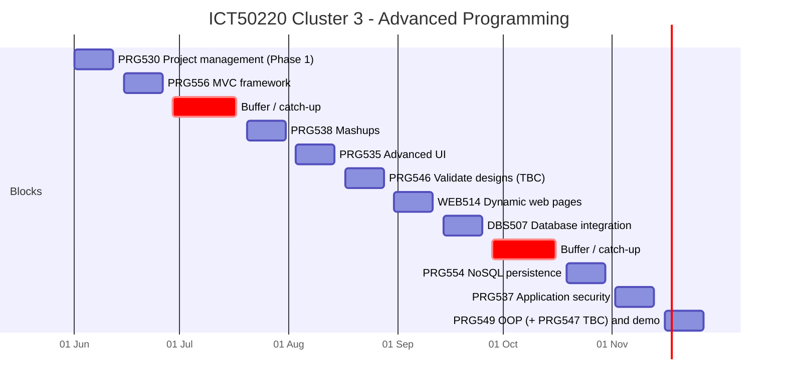

# Gantt Chart - Cluster 3 (01/06/2026 - 27/11/2026)

GitHub renders this chart automatically. You may also recreate it in draw.io for your evidence screenshot.
*Items marked TBC need trainer confirmation.*

